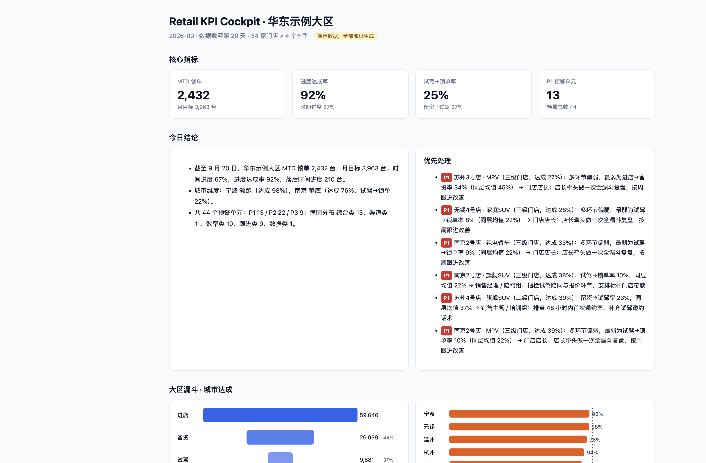
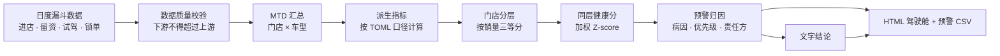
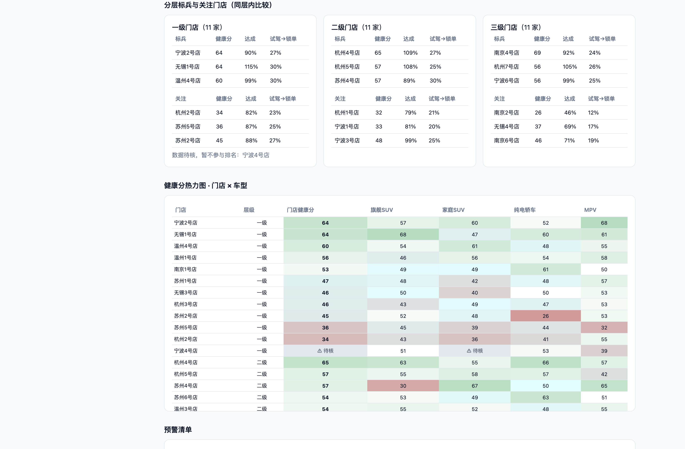

# Retail KPI Cockpit

**把门店日报变成「今天先管谁、为什么、找谁管」的经营驾驶舱。**

一个零依赖的零售经营诊断引擎：读入「门店 × 车型」日度漏斗数据，按配置文件里的指标口径计算达成与转化，
在同层级门店内打健康分，自动归因预警、分派责任方，并生成一页可以直接转发的 HTML 驾驶舱。

> 本仓库所有数据均由 `data/generate.py` 以固定随机种子生成，不含任何真实企业数据。



## 解决什么问题

区域销售管理者每天面对几十家门店、上百个「门店 × 车型」组合的报表，常见的痛点是：

| 痛点 | 本项目的做法 |
|---|---|
| 报表只有数字，没有结论，看完不知道先管谁 | 自动生成文字结论，按 P1 / P2 / P3 排出优先处理清单 |
| 全区混排，大店垄断标兵榜，小店找不到对标对象 | 按销量把门店切成三层，健康分与排名只在同层内比较 |
| 知道「达成率低」，不知道问题出在漏斗哪一环 | 对留资、试驾、锁单三段转化率做同层 Z-score，定位最弱环节 |
| 问题发现了，但不清楚该谁跟进 | 病因与责任方、建议动作一一映射，写在配置里 |
| 一条导入错误的数据就能让门店冲上标兵榜 | 漏斗上下游校验，异常单元标记「待核」，不参与打分和排名 |
| 改一个指标口径要改代码 | 指标口径、权重、阈值全部写在 `config/metrics.toml` |

## 方案架构



| 模块 | 职责 |
|---|---|
| `kpi_engine/data.py` | 读取日度数据，汇总 MTD 原子指标，做漏斗上下游一致性校验 |
| `kpi_engine/metrics.py` | 按配置计算派生指标（每个指标 = 分子 / 分母） |
| `kpi_engine/diagnosis.py` | 门店分层、同层 Z-score 健康分，异常数据不参与打分 |
| `kpi_engine/alerts.py` | 判定病因（渠道 / 跟进 / 效率 / 综合 / 数据），定优先级与责任方 |
| `kpi_engine/narrative.py` | 把诊断结果翻译成管理者可以直接转发的句子 |
| `kpi_engine/render.py` | 生成单文件 HTML 驾驶舱，内联 SVG 图表，无外部依赖 |

## 诊断规则

**健康分**：同层门店内，对三段转化率分别计算 Z-score，按权重加总后映射为 `50 + 15 × 加权 Z`，截断到 0–100。
默认权重为留资 0.25、试驾 0.30、锁单 0.45。

**病因判定**（Z-score 低于 -1 即命中）：

| 病因 | 判定指标 | 责任方 |
|---|---|---|
| 渠道类 | 进店→留资率偏低 | 大区运营 / 品牌活动组 |
| 跟进类 | 留资→试驾率偏低 | 销售主管 / 培训组 |
| 效率类 | 试驾→锁单率偏低（试驾样本 ≥ 8 才判定） | 销售经理 / 陪驾组 |
| 综合类 | 同时命中多项，或无单一病因但达成严重落后 | 门店店长 |
| 数据类 | 任意一天下游数量超过上游 | BI 数据链路 |

**优先级**：时间进度达成率低于 60% 为 P1，低于 85% 为 P2，其余未达成为 P3；数据类固定为 P2。
月目标低于 6 台的单元波动太大，只做数据校验，不参与达成预警。



## 快速开始

需要 Python 3.11 及以上，无第三方依赖。

```bash
python3 data/generate.py      # 生成演示数据（可选，仓库已附带）
python3 run.py                # 生成 docs/index.html 与 docs/alerts.csv
python3 run.py --as-of 25     # 指定数据截至当月第几天
python3 -m unittest discover -s tests
```

`docs/` 目录可直接用 GitHub Pages 托管，打开即是驾驶舱。

## 设计取舍

- **规则模型而非机器学习**：门店经营诊断的使用者是一线管理者，每条预警都要能说清「为什么是它」。
  Z-score 加阈值的规则足够解释，口径变化时改配置即可。
- **同层比较**：牺牲了「全区第一」这种直观排名，换来小店也有可学习的同层标兵。
- **少即是多**：首屏只放 4 个核心指标和 6 条优先处理事项，完整清单放在下方和 CSV 中。

## 背景

本项目是作者在汽车零售销售策略实习中所做经营驾驶舱的公开复刻版：保留了指标口径引擎、门店分层、
健康分诊断与预警分派的产品设计，数据与门店全部替换为虚构内容。
